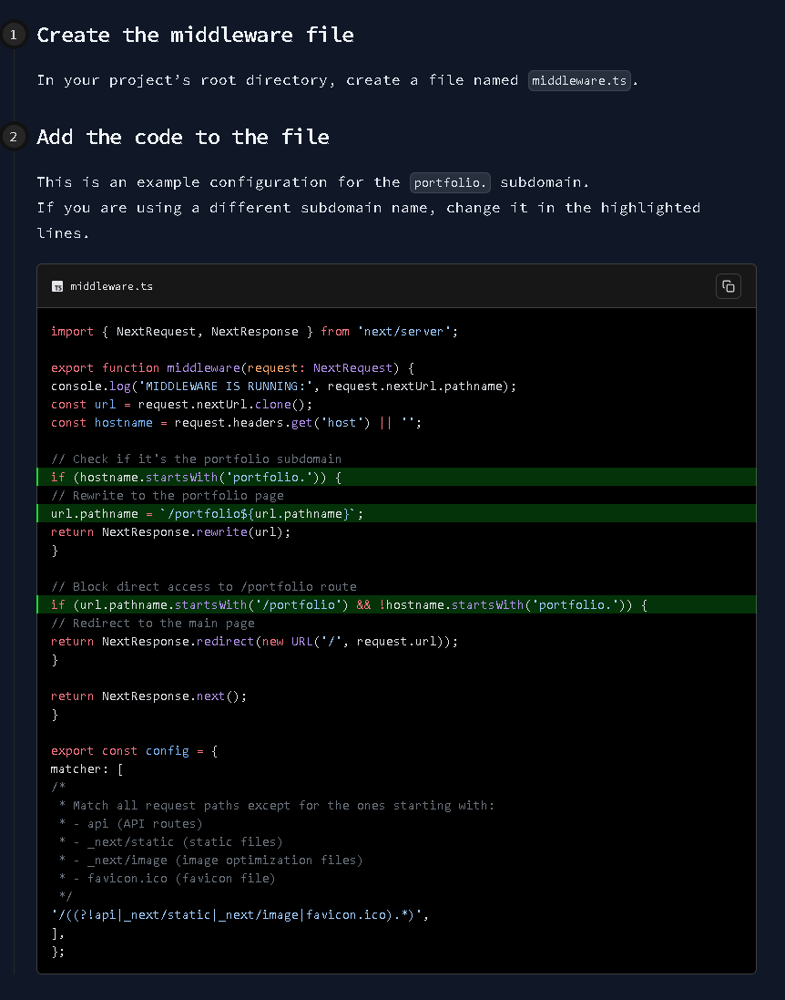

# Nextra Documentation Website Template

---

This is a customizable documentation website template built with [Nextra](https://nextra.site/).

It’s adapted from the original [Nextra Docs Template](https://github.com/shuding/nextra-docs-template), with updates tailored for 
Nextra V4, including support for [MDX](https://mdxjs.com/) and [Tailwind CSS](https://tailwindcss.com/) using TypeScript.

Designed for deployment as a standalone site or under a subdomain, it’s ready to go out of the box with a preconfigured Navbar and Footer and translation context based on this 
[Next.JS translation template](https://lpj.app/projects/nextjs-translation-template) project

You might ask, why this template is preconfigured as a standalone site and not as a submodule of your existing Next.JS project? <br/>
The reason lies in some quirks with Nextra V4. When used alongside the App Router in a larger Next.js application, Nextra can inadvertently expose all 
your regular site pages and subpages within the documentation sidebar — cluttering the navigation and breaking the intended separation between your main site and its docs.
<br/>

If you want to learn how to deploy this template via Docker on your server, check out my guide to [Deploy Next.js websites with Docker](https://www.blog.lpj.app/docker/deploy-nextjs-websites-with-docker)

---
# Content
- [Demo](#demo)
- [Usage](#usage)
- [Write articles](#write-articles)
- [Customization](#customization)
    - [Layout.tsx](#layouttsx)
        - [Theme](#theme)
        - [Feedback link and content](#feedback-link-and-content)
    - [Design](#design)
    - [Metadata](#metadata)
- [License](#license)

---

## Demo
See for example my blog in action here: <br/>
[](https://www.blog.lpj.app/)

---
## Usage
The template provides a few sample articles and category structures to help illustrate how a documentation site can be organized. <br/>
The **main directory** for your articles is the `src/content` directory. <br/>
Each folder in `src/content` **represents a category**. <br/>
Article files with your content can be created inside category folders or your content directory. <br/>

To customize the order of your categories or articles there's a `_meta.js` file in your content directory or each category folder.

The example below shows how to customize the order of your articles and categories in the `src/content` directory.
```tsx 
// src/content/_meta.js
const meta = {
    index: "",
    "top-category-1": "Top category 1",
    "another-article": "Another article",
    "top-category-2": "Top category 2",
};

export default meta;
```

To put it simply, the `_meta.js` file only determines the visual order in which the articles or category folders are displayed. <br/> 
It's best to take a look at the [demo](#demo) and then at the code structure of this template, then it should be relatively easy to understand. <br/>

This is for example the `src/content/top-category-1` folder structure:
```tsx 
src/content/top-category-1
├── _meta.js
├── category-1-first-article.mdx
├── category-1-second-article.mdx
```

The `_meta.js` file in the `top-category-1` folder looks like this:
```tsx 
// src/content/top-category-1/_meta.js
const meta = {
    "category-1-first-article": "Category 1 - First article",
    "category-1-second-article": "Category 1 - Second article",
};

export default meta;
```
Here you can see that the order of the articles is determined by the keys in the `_meta.js` file and the values are the titles of the articles.

The `_meta.js` file is optional. If it's not present, the folder name will be used as the article title. <br/>
And the order is sorted alphabetically in ascending order by default. <br>

---
## Write articles
Articles are written in [MDX](https://mdxjs.com/) and can be written in Markdown. <br/>
MDX is a syntax extension to Markdown that allows you to write JSX inside your Markdown files. <br/>
This allows you to integrate some cool Things like a guide with steps and interactive code examples like here: <br/>


The best way to learn MDX is to check out the [MDX docs](https://mdxjs.com/getting-started) and fuck around and find out until your happy with your article. <br/>


--- 
## Customization

### Layout.tsx

#### Theme
To enable or disable the Dark-Light-Mode, set the `darkMode` property in `app/layout.tsx`. to true or false. (This also hides the dark-light mode toggle button in your sidebar ) <br/>
To force a theme, set `forcedTheme` property in under `nextThemes` in `app/layout.tsx`. to `dark` or `light`.

#### Feedback link and content
To set the feedback link and content, edit `content` and `link` `feedback` property in `app/layout.tsx`.
This is the feedback link that appears at the top right of every page.

```tsx 
...
export default async function RootLayout({
                                             children,
                                         }: {
    children: ReactNode;
}) {
    return (
        <html lang="en" dir="ltr" suppressHydrationWarning>
        <Head/>
        <body
            className={`${sourceCodePro.variable} ${sourceCodePro.className} antialiased`}
        >
            <LanguageProvider>
                <Navbar/>
                <Layout
                    pageMap={await getPageMap()}
                    editLink={null}
                    darkMode={false} {/*<-- Set this to true or false to enable or disable the Dark-Light-Mode*/}
                    sidebar={{autoCollapse: true}}
                    nextThemes={{forcedTheme: "dark", defaultTheme: "dark"}} {/*<-- Set this to "dark" or "light" to force a theme*/}

                    {/*Feedback link and content*/}
                    feedback={
                        {
                            content: "Question or suggestion? Contact me",
                            link: 'https://<your-domain>/contact'
                        }
                    }
                >
                    {children}
                </Layout>
                <Footer/>
            </LanguageProvider>
        </body>
        </html>
    );
}
```

### Design

To customize your design, edit the `app/global.css` file. In there, you can change the background color of your docs, highlight colors, fonts and more.

```tsx
/* css */
@import "tailwindcss";

/*Customize your overall background and foreground colors*/
:root {
    --background: #111827; /* tailwind gray-900 */
    --foreground: #e5e7eb; /* tailwind gray-200 */
    --font-source-code-pro: 'Source Code Pro', monospace;

    /* This is the value for the highlighting color */
    --nextra-primary-hue: 125;      /* 125deg */
    --nextra-primary-saturation: 100%;
}

/*The next lines applying the highlight colors to the dark mode*/
html.dark,
[data-theme='dark'] {
    --nextra-primary-hue: 125;
    --nextra-primary-saturation: 100%;
}

/*The next lines applying the background and foreground colors to your docs*/
@layer base {
    html, body {
        @apply bg-gray-900 text-gray-200;
    }
}

/* Sidebar toggle button container background color */
aside.nextra-sidebar-container,
aside.nextra-sidebar-container > div,
aside[class*='sidebar'] > div {
    background-color: var(--background) !important;
}

/* If you don't like a timestamp on your articles, uncomment the next line */
//.nextra-timestamp { display: none !important; }
```

### Metadata
To customize your docs site metadata or page title, edit the `src/app/[[...mdxPath]]/page.jsx`
Uncomment the per page metadata if you want or set general overall page metadata.
```tsx
import { generateStaticParamsFor, importPage } from "nextra/pages";
import { useMDXComponents } from "@/mdx-components";

export const generateStaticParams = generateStaticParamsFor("mdxPath");

/* Page route metadata
export async function generateMetadata(props) {
  const params = await props.params;
  const mdxPath = params?.mdxPath ?? [];
  const { metadata } = await importPage(mdxPath);
  return metadata;
}
*/

// General overall page metadata
export const metadata = {
  title: "Blog - your-website",
  description: "Blog - your-website",
};

const Wrapper = useMDXComponents().wrapper;

export default async function Page(props) {
  const params = await props.params;
  const mdxPath = params?.mdxPath ?? [];
  const result = await importPage(mdxPath);

  // Page route metadata
  //const { default: MDXContent, toc, metadata } = result;

  // General overall page metadata
  const { default: MDXContent, toc, metadata } = result;

  return (
    <Wrapper toc={toc} metadata={metadata}>
      <MDXContent {...props} params={params} />
    </Wrapper>
  );
}
```

#### Custom created and updated timestamps
If you want timestamps on your articles like when it was created or last updated, you can add the following to your `src/app/[[...mdxPath]]/page.jsx` file:
```tsx
import { DocMeta } from '../../components/PageMetadata'

/* ... your content */

<DocMeta created={"20.10.2025"} updated={"02.12.2025"}/>
```

Now you will see a timestamp on your articles at the bottom left and right. <br/>
If you want to display it on top, just move the `<DocMeta .../>` component above your content. <br/>
If you only want to show the last updated timestamp, you can remove the created timestamp, both timestamps are not mandatory.
Also if you only want e.g a updated timestamp, you can remove the created timestamp and it will still show up on the right side. 

---
## License

See [LICENSE](./LICENSE).

--- 

&copy; [lpj.app](https://github.com/lpj-app). Licensed under MIT.